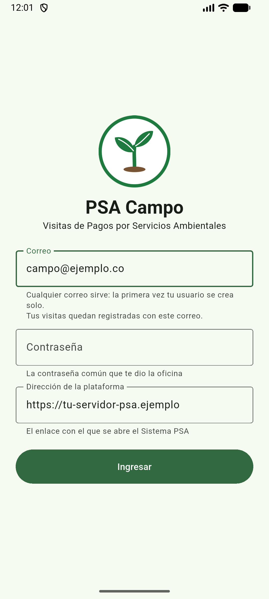
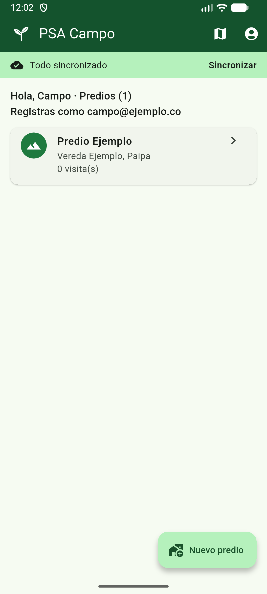
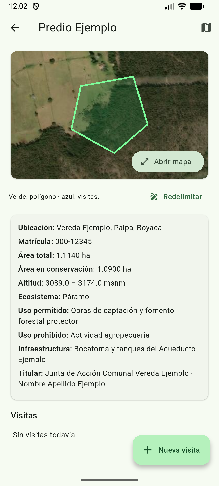
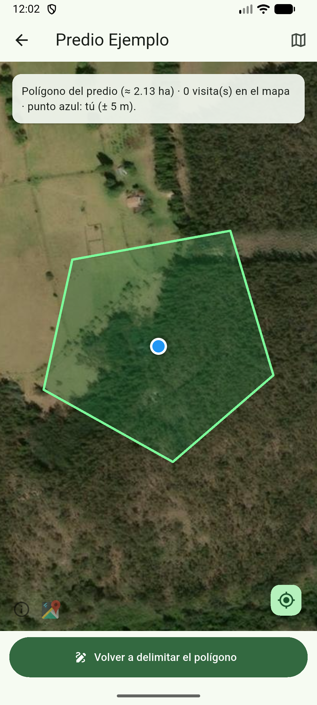
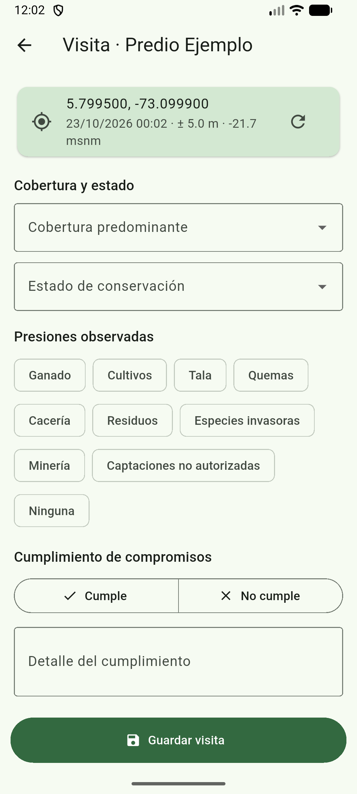

# PSA Campo — App Android para visitas de campo de programas PSA

Aplicación móvil (Flutter) que usan los técnicos de campo del **[Proyecto PSA](https://github.com/ricardoprs76-max/psa)** para visitar los predios de un programa de Pagos por Servicios Ambientales, incluso sin señal, y enviar luego a la plataforma central la ubicación, las fotos y la firma de cada visita.

## Problema que resuelve
Los predios en conservación suelen quedar en páramos y zonas rurales sin cobertura. Las visitas se registraban en papel y luego se transcribían, con pérdida de datos y sin evidencia georreferenciada. PSA Campo trabaja sin conexión y sincroniza todo cuando vuelve la señal.

## Tecnologías
- **Flutter / Dart** (Android)
- **SQLite** (`sqflite`) como base local sin conexión
- **flutter_map** + **latlong2** (mapa del predio y su polígono)
- **geolocator** (GPS con precisión y altitud), **image_picker** (fotos)
- API REST de la plataforma [Proyecto PSA](https://github.com/ricardoprs76-max/psa) (`http`)

## Funcionalidades principales
- Inicio de sesión con el correo de la persona y la contraseña común que da la oficina (la primera vez el usuario se crea solo como funcionario de campo).
- Lista de predios asignados con vereda y municipio, disponible sin conexión.
- Ficha del predio y mapa con su polígono de conservación.
- **Formulario de visita:** coordenadas GPS con precisión y altitud, fotos y firma en pantalla.
- **Sincronización** con la plataforma: cola de envío con reintento automático cada minuto, indicador de estado y resolución de conflictos (la persona elige qué versión conservar).
- Las visitas enviadas aparecen en el mapa web del Proyecto PSA.

## Capturas de pantalla
Capturas tomadas con datos ficticios, conectada a una plataforma [Proyecto PSA](https://github.com/ricardoprs76-max/psa) de prueba.

| Ingreso | Predios asignados | Ficha del predio |
|---|---|---|
|  |  |  |

| Mapa (polígono y GPS) | Formulario de visita |
|---|---|
|  |  |

## Instalación y uso
**Requisitos:** Flutter 3.x (Dart 3) y Android SDK.

```bash
git clone https://github.com/ricardoprs76-max/psa-campo.git
cd psa-campo
flutter pub get
flutter run                                                     # en un dispositivo o emulador
flutter build apk --dart-define=SERVIDOR=https://tu-servidor    # APK apuntando a tu servidor PSA
```
Al abrir la app, escribe la dirección del servidor (si no se fijó al compilar) e ingresa con un usuario creado en la plataforma [Proyecto PSA](https://github.com/ricardoprs76-max/psa). El primer ingreso necesita internet; después funciona sin conexión.

## Proyectos relacionados
- **[Proyecto PSA](https://github.com/ricardoprs76-max/psa):** plataforma web central (Next.js + PostgreSQL/PostGIS) donde se gestionan los convenios, predios, expedientes y pagos, y adonde llegan las visitas de esta app.

## Contacto
**Ricardo Augusto Porras Díaz** — Desarrollador de software y abogado especialista en derecho administrativo
- Correo: [ricardoprs76@gmail.com](mailto:ricardoprs76@gmail.com)
- GitHub: [github.com/ricardoprs76-max](https://github.com/ricardoprs76-max)
